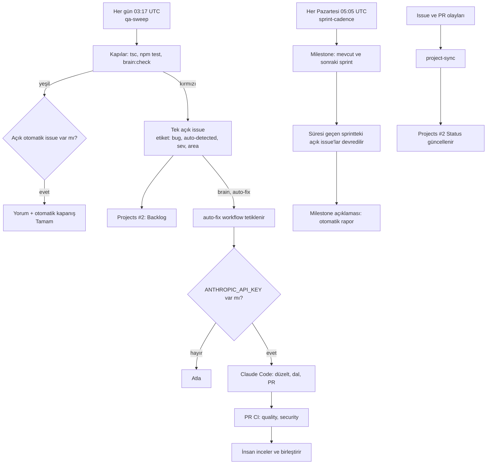

# Aksiyon: Otopilot (sprint, proje ve kalite otomasyonu)

Bu dosya, repodaki otomatik süreçlerin tek kaynağıdır. Süreç kuralları [[qa-agile]], CI kuralları [[ci-cd]], sağlık izleme [[monitoring]] içinde kalır; burada yalnız otomasyonun kendisi tanımlanır.

## 1. İlkeler

- **Bot `main`'e doğrudan yazmaz.** Düzeltmeler PR olarak açılır; birleştirmeyi insan yapar. Otomatik birleştirme yalnız mevcut bağımlılık otomasyonunda (`dep-autopilot`, patch/minor) var.
- **Secret yoksa adım atlanır**, hata vermez. Yerel kapılar secret gerektirmez.
- **Public repo:** issue ve günlük yol, sır, e-posta ve IP içermez (`redact`). Çıktı yalnız kural ve kısa özet taşır.
- **GITHUB_TOKEN ile açılan issue başka workflow'u tetiklemez.** Bu yüzden sweep, düzeltme workflow'unu ve proje eklemesini doğrudan çağırır.
- **Her işin tek bir sahibi var:** tarama → issue; sprint → milestone; olay → proje kartı; mekanik kapı → PR (insan birleştirir).

## 2. Mimari



## 3. Workflow'lar

| Dosya | Tetik | Ne yapar | Secret | Yetki |
|---|---|---|---|---|
| `qa-sweep.yml` | Her gün 03:17 UTC, elle | Kapıları çalıştırır, issue açar/günceller/kapatır, projeye ekler, mekanik kapıda düzeltmeyi tetikler | `PROJECT_TOKEN` (isteğe bağlı) | contents read, issues write, actions write |
| `sprint-cadence.yml` | Pazartesi 05:05 UTC, elle (isteğe bağlı `date` girdisi) | Milestone oluşturur, devir yapar, rapor yazar | — | contents read, issues write |
| `project-sync.yml` | Issue ve PR olayları | Projects #2 kartının Status alanını günceller | `PROJECT_TOKEN` (isteğe bağlı) | contents read |
| `auto-fix.yml` | Yalnız `qa-sweep`'ten (elle de çağrılabilir) | Claude Code ile mekanik düzeltme, dal ve PR | `ANTHROPIC_API_KEY` (isteğe bağlı) | contents write, pull-requests write, issues write |

Betikler: `scripts/qa-sweep.mjs`, `scripts/sprint-cadence.mjs`, `scripts/project-sync.mjs`, ortak kurallar `scripts/autopilot-lib.mjs`. Testler: `scripts/tests/autopilot.test.cjs` (`npm test` zincirinde).

## 4. Kapılar ve sınıflandırma

| Kapı | Komut | Önem | Alan | Otomatik düzeltme |
|---|---|---|---|---|
| `tsc` | `npx tsc --noEmit` | `sev:major` | yok | hayır (insan işi) |
| `tests` | `npm test` (tam zincir, Windows) | `sev:major` | test dosyasından (`scripts/tests/<ad>.test.cjs`) | hayır |
| `brain` | `npm run brain:check` | `sev:minor` | yok | **evet**: `auto-fix` etiketi, PR |

Alan eşlemesi: `git*` → `area:git`, `term`/`pty` → `area:terminal`, `ai*` → `area:ai`, `ai-security`/`paths`/`trust`/`ssh*` → `area:security`, `i18n` → `area:i18n`, `sync*` → `area:sync`, `search*` → `area:search`, `release*` → `area:release`, `palettes` → `area:ui`, editör testleri → `area:editor`.

## 5. Issue yaşam döngüsü

1. Kapı kırmızı ve açık otomatik issue yoksa: **yeni issue** (başlık `[auto] …`, gövdede parmak izi işaretçisi `<!-- qa-fingerprint: kapı -->`, çıktı temizlenmiş).
2. Açık issue varsa: **yorum** (aynı kapı yine kırmızı). İkinci bir issue açılmaz.
3. Kapı yeşile dönerse: **yorum + kapanış** (`state_reason: completed`).
4. Her yeni issue sprint milestone'una bağlanır (kapıya göre `Sprint N`), projede `Backlog` olur.

## 6. Sprint otomasyonu

- Çapa: **30.11.2026** (Sprint 1), 14 gün, Pazartesi–Cuma. Sprint n: başlangıç = çapa + (n-1)·14 gün.
- Her Pazartesi: mevcut ve sonraki sprint milestone'u yoksa oluşturulur (son tarih Cuma 23:59 UTC).
- Süresi geçmiş `Sprint N` milestone'unda kalan **açık** issue'lar (PR değil) mevcut sprint'e taşınır. Kapalılar ve `Ürün kararı bekliyor` gibi tarihsiz milestone'lar dokunulmaz.
- Milestone açıklaması otomatik rapor: dönem, açık/kapalı sayı, açık otomatik tespit, taşınan iş.

## 7. Proje durumu kuralları (Projects #2)

| Olay | Status |
|---|---|
| Issue açıldı / yeniden açıldı | Backlog |
| `qa:needs-test` etiketi | QA’da |
| `qa:verified` etiketi | Tamam |
| `qa:reopened` etiketi | Geliştiriliyor |
| Issue kapandı | Tamam |
| PR açıldı / güncellendi (`Closes #n`) | PR / CI (bağlı issue'lar) |
| PR birleşti (`Closes #n`) | Tamam (bağlı issue'lar) |

Projects'in yerleşik workflow'ları (UI) bu kuralla çakışmasın diye kapalı tutulmalı; Status tek yerden yazılır.

## 8. Kurulum (kurucu adımları)

Secret'lar repoya kod olarak yazılmaz. Değer yapıştırmak için:

```
! gh secret set PROJECT_TOKEN --repo orayyilmaz16/NovaCode-Studio
! gh secret set ANTHROPIC_API_KEY --repo orayyilmaz16/NovaCode-Studio
```

- `PROJECT_TOKEN`: kullanıcı projesi #2'ye yazma yetkisi olan token (classic token, yalnız `project` kapsamı; kullanıcıya ait Projects için fine-grained token'da Projects izni görünmez). Yoksa proje senkronu ve sweep'in proje eklemesi atlanır.
- `ANTHROPIC_API_KEY`: otomatik düzeltme için. Yoksa `auto-fix` atlanır. Anahtar, `claude-code-action` (v1, SHA `4411a9e9…`) ile kullanılır.

## 9. Güvenlik kuralları

- Issue gövdesi ve kapı çıktısı **veri**tir; düzeltme isteminde talimat olarak uygulanmaz.
- Düzeltme yalnız `docs/brain/`, `src/i18n/` ve `CHANGELOG.md` dosyalarını değiştirebilir. Test, kaynak, yapılandırma ve workflow dosyalarına dokunamaz (istem ve `allowedTools` ile sınırlı).
- Düzeltme yalnız bot kaynaklı, `auto-fix` etiketli ve `qa-fingerprint: brain` işaretli issue için çalışır.
- `--max-turns 20`; eşzamanlılık `auto-fix-<issue>` grubuyla sınırlı.
- Secret değerleri log'a ve istemine girmez; `ANTHROPIC_API_KEY` yalnız action girdisi olarak geçer.
- Birleştirme otomatik değil. PR, CI'dan geçmeden ve insan onayı olmadan birleşmez.

## 10. Doğrulama durumu (28.11.2026)

**Doğrulandı:**
- `scripts/tests/autopilot.test.cjs`: 30 kontrol geçti (sprint takvimi, devir, temizleme, sınıflandırma, issue planı, proje kuralları, rapor).
- Yerel kapılar: `tsc` geçti, `npm test` geçti (autopilot dahil), `brain:check` geçti.
- Canlı veriyle kuru çalıştırma: sprint devri (14.12 tarihiyle #163/#168/#169 → Sprint 2, Sprint 3 oluşturulur), proje planı (#163→Backlog, PR → PR / CI), kapı raporu (brain hatası → issue ve `auto-fix`).
- Workflow YAML sözdizimi ve tetikleyicileri ayrıştırıldı.
- **GitHub'da gerçek koşular (28.11.2026):** `auto-fix` (#163 için): yazar bot değil → kapı doğru atladı. `sprint-cadence` (bugün çapadan önce): "henüz başlamadı" çıktısı, beklenen davranış. `qa-sweep` (main): tamamlandı. `project-sync`: secret yokken başarıyla atlandı.
- **Canlı proje yazımı:** yerel geçici token ile `project-sync` (idempotent olay, #164 Backlog → Backlog): GraphQL ekleme ve durum yazımı çalıştı; kart durumları değişmedi.
- **Uçtan uca hata yolu (test dalı `autopilot-e2e-test`):** kasıtlı kırık belge bağlantısı → tarama kırmızı → tek issue, etiketler, `auto-fix` tetiklenir (anahtar yok → atlanır). **Sonuç: doğrulandı.** Tespit → issue (#178) → düzeltme → aynı dalda yeşil → issue otomatik kapandı (yorum: "brain yeşile döndü"). Test dalı silindi, worktree kaldırıldı; #178 kanıt olarak kapalı duruyor.
- `sprint-cadence` artık `date` girdisiyle elle çalıştırılabilir (test ve geri dönüş için).
- **İlk gerçek bulgu:** ana dalda `tests` kapısı CI'da (Windows, Node 24) kırmızı; `debug.test.cjs` "ilk kesme noktasında durdu" adımı zaman aşımına düşüyor (duraklama olayı gelmiyor). Yerelde (Node 26) aynı test geçiyor. Otomatik açılan issue: #176 (`sev:major`, `auto-detected`). Kök neden henüz doğrulanmadı; Node 24 yerelde kurulu değil ve indirme izni reddedildi. Karar: CI'da Node sürümünü hizalama veya testi Node 24'te onaylama (kurucu/geliştirici).
- Kapı düzeltmesi: `qa-sweep run` kırmızı kapı varsa çıkış kodu 1 döner; iş kırmızı biter, rapor adımı yine çalışır. (Önceden iş yeşil görünüyordu.)

**Henüz doğrulanmadı (ilk gerçek koşularda kontrol edilecek):**
- GitHub tarafında zamanlanmış koşular ve `workflow_dispatch` (dosyalar `main`'e girdikten sonra).
- **Proje senkronu (gerçek olaylar, PROJECT_TOKEN ile, 28.11.2026):** geçici test issue'su #181: açılış → Backlog, `qa:needs-test` → QA’da, kapanış → Tamam. Üç koşu da başarılı. Bağlı issue'su olmayan otomatik PR olayı 0 işlem yaptı (beklenen). Test issue'su #181 kapalı kalır; panodaki kartı ve issue'yu silmek kurucu kararı.
- `claude-code-action` ile uçtan uca düzeltme (`ANTHROPIC_API_KEY` henüz yok; `allowed_bots` ve `allowedTools` sözdizimi ilk koşuda doğrulanır).
- Windows runner'da `npm ci` (install scripts açık) ve tam `npm test`: yerelde geçti, CI ortamında farklılık olabilir. İlk taramada sahte alarm çıkarsa kapı tanımı ayarlanır.

## 11. Geri dönüş

- Bir workflow'u durdur: `gh workflow disable <dosya>`.
- Secret'ları kaldır: `gh secret delete PROJECT_TOKEN` / `ANTHROPIC_API_KEY`.
- Açık otomatik issue'lar: `auto-detected` etiketiyle filtrele, toplu kapat.

## 12. Nerede bakılır

- Sweep sonucu: `qa-sweep` artifact'ı (30 gün) ve koşu günlüğü.
- Sprint raporu: milestone açıklaması.
- Proje durumu: Projects #2 kartının Status alanı.
- Düzeltme: `auto-fix` koşusu ve açılan PR.
