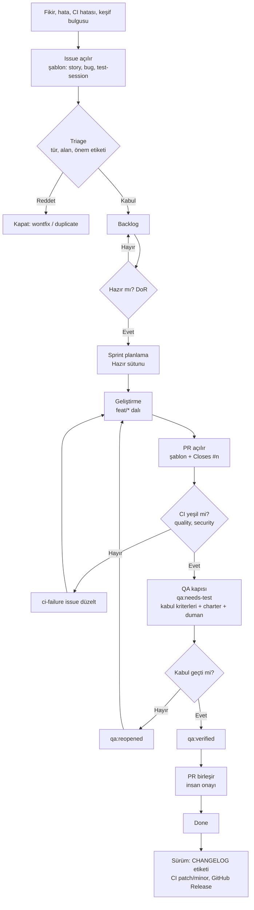

# Aksiyon: QA ve çevik süreç

Bu dosya sürecin tek kaynağıdır. Md altyapısı: [[QA]] (indeks), [[SMOKE]] (duman/regresyon listesi), [[CHARTERS]] (keşif oturumları), [[SPRINTS]] (sprint günlüğü). Otomatik testlerin ayrıntısı [[testing]] içinde kalır.

## 1. İş akışı



## 2. Project sütunları (Status) ve etiketler

| Sütun | Anlamı | Giriş koşulu | Etiket |
|---|---|---|---|
| Backlog | Triage'dan geçti, hazır değil | Tür ve alan etiketi var | `triage` kalkar |
| Hazır | DoR tamam, sprint'e alınabilir | Bölüm 4 DoR | — |
| Geliştiriliyor | Dal açıldı | `feat/*` dalı | — |
| PR / CI | PR açık, CI koşuyor | PR açıldı | — |
| QA’da | CI yeşil, test sürüyor | CI yeşil | `qa:needs-test` |
| Tamam | Kabul geçti | QA kabul | `qa:verified` |

QA kaldıysa kart **Geliştiriliyor** sütununa döner ve `qa:reopened` eklenir. Test durumu ayrı bir alandır (Bölüm 10).

## 3. Önem ve öncelik (ikisi farklıdır)

| Ölçü | Kim belirler | Nerede | Anlamı |
|---|---|---|---|
| Önem (`sev:*`) | QA | Etiket | Hatanın etkisi: critical, major, minor, trivial |
| Öncelik (P0–P3) | Kurucu / ürün | Project alanı | Ne zaman yapılacağı |

Kural: açık `sev:critical` veya `sev:major` varsa sürüm adayı çıkmaz. Önem bir karara dönüşürse ürün kararı [[DECISIONS]] içine yazılır.

Alan etiketleri: `area:editor`, `area:git`, `area:terminal`, `area:ai`, `area:explorer`, `area:search`, `area:ui`, `area:i18n`, `area:sync`, `area:security`, `area:release`. Erişilebilirlik için mevcut `accessibility` etiketi kullanılır.

## 4. Hazır (DoR) ve Bitti (DoD)

**Hazır (DoR), sprint'e girmeden:**
- En az bir kabul kriteri, Verilen / Eğer / Sonra biçiminde ve test edilebilir.
- Tür ve alan etiketi var; büyüklük (XS–XL) girildi.
- Arayüz metni varsa 8 dil planlandı (tr, en, de, ru, ar, es, fr, az).
- Kişisel veri, 3. parti servis veya analitik etkisi işaretlendi ([[security-kvkk]]).
- Bağımlılık (açık issue, dış servis, sertifika) yok ya da not edildi.

**Bitti (DoD), Tamam sütununa geçmeden:**
- PR'da `npx tsc --noEmit`, `npm test`, `npm run brain:check` ve `npm run build` yeşil (CI `quality`).
- Her kabul kriteri QA'da geçti; kriter tek tek işaretlendi.
- Kullanıcıya görünen değişiklik varsa `CHANGELOG.md` `Unreleased` içinde tr ve en maddeleri var.
- İlgili aksiyon dosyası ve karar varsa [[DECISIONS]] güncel ([[doc-sync]]).
- Açık `sev:critical` / `sev:major` yok; ilgili [[SMOKE]] maddeleri işaretlendi.

## 5. Test seviyeleri

| Seviye | Ne kontrol eder | Nasıl | Kim | Ne zaman |
|---|---|---|---|---|
| Statik | Tip, hijyen, bağımlılık | `npx tsc --noEmit`, CI `quality` | CI | Her PR |
| Birim ve entegrasyon | Git, IPC, arama, güvenlik, i18n | `npm test` (`scripts/tests/`) | CI ve geliştirici | Her PR |
| Belge ve i18n | Beyin bağlantıları, 8 dil | `npm run brain:check` | CI | Her PR |
| Derleme ve bütçe | Paket boyutu | `npm run build`, `check-bundle.mjs` | CI | Her PR |
| Güvenlik | Bağımlılık, CodeQL, gizli bilgi | `security.yml`, `npm audit` | CI | Her PR ve haftalık |
| Keşif (charter) | Yeni özellik, riskli alan | [[CHARTERS]] şablonu, `test-session` issue | QA | Yeni özellik ve riskli değişiklik |
| Duman | Ana akışların açılıp çalıştığı | [[SMOKE]] | QA | Her sürüm adayı |
| Regresyon | Geçmiş hataların geri gelmemesi | [[SMOKE]] + [[BACKLOG]] kapalı bulguları | QA | Her sürüm öncesi |
| Erişilebilirlik | Klavye, kontrast, RTL | [[SMOKE]] SM-19, elle | QA | Arayüz değişikliği |

Otomatik testler bir şeyi kanıtlar, ama arayüzü kanıtlamaz. Arayüz değişikliği için keşif oturumu ve duman testi zorunludur. Görsel doğrulama için [[testing]] içindeki izole Electron yöntemi kullanılır.

## 6. Sprint takvimi

- Süre: 2 hafta (Pazartesi – Cuma).
- **Pazartesi, planlama:** hedef tek cümle, kapsam Hazır sütunundan.
- **Sprint içi:** iş günleri [[SPRINTS]] içine kısa not. Kart takılırsa engel issue'da yazılır.
- **Cuma, son gün:** sprint incelemesi (QA sonuçları, kapanan kartlar) ve retro (Devam / Dur / Dene). Sonuç [[SPRINTS]] içine yazılır.
- Sprint 1 önerisi: **30.11.2026 – 11.12.2026**. Hedef: QA altyapısını çalıştırmak ve [[BACKLOG]] içindeki açık kalemlerden ilk duman turunu yapmak. Onay bekliyor.

## 7. Roller

- **Kurucu (ürün):** kapsam, öncelik (P0–P3), yayın kararı.
- **Geliştirici:** insan ve Claude Code. Ajan DoD kontrolünü yapar; QA kabulünü ve PR birleşmesini ajan tek başına vermez.
- **QA:** triage'da `sev:*` ve alan etiketi, keşif oturumları, duman ve regresyon, `qa:verified` / `qa:reopened`.

## 8. Mevcut otomasyon ile ilişki

- `ci-failure-issue.yml`: CI kırılınca otomatik issue (`ci-failure`). Bu issue triage'a düşer.
- `health-monitor.yml`: tek issue altında sağlık ve güvenlik bulguları (`health-monitor`).
- Dependabot ve `dep-autopilot`: bağımlılık PR'ları (`dependencies`, `safe-update`, `major-review`).
- `auto-release.yml`, `release.mjs`: sürüm düzeyi CHANGELOG etiketlerinden gelir ([[versioning]]).
- Stop hook `auto-commit`: değişiklikleri otomatik commit ve push eder ([[doc-sync]]).

**Açık süreç çakışması:** Stop hook değişiklikleri `main`e ya da `auto/*` dalına gönderir. QA kapısı yalnız PR üzerinden işler. Öneri: özellik ve hata işleri `feat/*` dalında PR ile geçsin; yalnız belge ve bakım işleri otomatik commit ile gitsin. Karar kurucuda; açık durum [[DECISIONS]] (28.11.2026) kaydında.

## 9. Kurallar (KVKK ve gizlilik)

- Test verisi örnek proje olur. Gerçek kullanıcı verisi, gerçek token, `.env` ve sunucu IP'si issue, PR veya ekran görüntüsüne girmez.
- Windows yolu (kullanıcı adı içeren) ekran görüntüsünde kırpılır veya bulanıklaştırılır ([[security-kvkk]], S-14).
- Güvenlik açığı issue ile bildirilmez; [[SECURITY]] yolu kullanılır.
- Dış servise giden veri değişiklik varsa veri, amaç, hukuki sebep, saklama ve yurt dışı aktarım işaretlenir.

## 10. GitHub Project (durum: kuruldu, 28.11.2026)

Proje: https://github.com/users/orayyilmaz16/projects/2 (numara 2, repoya bağlı, özel). Alanlar: **Status** (Backlog, Hazır, Geliştiriliyor, PR / CI, QA’da, Tamam), **Öncelik** (P0–P3), **Büyüklük** (XS–XL), **Test durumu** (Test edilmedi, Geçti, Kaldı, Bloke). Sprint ataması için Projects'in yerleşik **Milestone** alanı kullanılır. Aşağıdaki komutlar kurulum kaydıdır; tekrar çalıştırılmaz.

Kalan elle adımlar: arayüz otomasyonları (madde 6) ve isteğe bağlı workflow (aşağıda).

### Kurulum kaydı

**Kurulan (28.11.2026):** 8 açık backlog kalemi issue oldu (#163–#170, alan ve önem etiketli). 39 etiket (QA, önem, alan ve `triage` dahil), issue şablonları `user_story` ve `test_session`, `bug_report` önem ve tekrar alanları, PR şablonunda QA kutuları.

**Milestone'lar (28.11.2026):** `Sprint 1` (son tarih 11.12.2026), `Sprint 2` (25.12.2026), `Ürün kararı bekliyor` (son tarihsiz). Sprint issue'ları ilgili sprint milestone'una, kurucu kararı bekleyenler karar milestone'una bağlanır. Sürüm milestone'ları, sürüm planı netleşince eklenir.

**Bekleyen:** Projects için token kapsamı yok (`read:project`, `project`). Kullanıcı bunu tarayıcıda yeniler:

```
! gh auth refresh -h github.com -s project,read:project
```

Kapsam verildikten sonra kurulum (komutlar çalıştırılmadan önce doğrulanır):

1. `gh project create --owner orayyilmaz16 --title "NovaCode Studio: Geliştirme ve QA" --format json`
2. `gh project link <numara> --owner orayyilmaz16 --repo orayyilmaz16/NovaCode-Studio`
3. Alanlar: `Öncelik` (P0, P1, P2, P3), `Büyüklük` (XS, S, M, L, XL), `Test durumu` (Test edilmedi, Geçti, Kaldı, Bloke). Komut: `gh project field-create <numara> --owner orayyilmaz16 --name "Öncelik" --data-type SINGLE_SELECT --single-select-options "P0,P1,P2,P3"`
4. `Status` seçeneklerini Bölüm 2'deki altı sütuna çevir. Varsayılan seçenekler arayüzden değiştirilir.
5. Sprint için ayrı alan eklenmedi; Milestone alanı kullanılıyor (Sprint 1, Sprint 2, Ürün kararı bekliyor).
6. Arayüz otomasyonları: "Item added" → Backlog; "Item closed" → Tamam; "PR merged" → Tamam.

Yeni issue'ları Project'e otomatik eklemek için bir workflow gerekir; `PROJECT_TOKEN` gizli değeri ister. Bu değer kurucu tarafından eklenir, koda yazılmaz.

## 11. Açık kararlar

- Özellik işleri PR'dan mı geçsin, yoksa otomatik commit ile `main`e mi gitsin? (Bölüm 8)
- Sprint 1 tarihleri: **onaylandı** (30.11.2026 – 11.12.2026).
- Açık [[BACKLOG]] kalemleri (S-04, S-18, I-05, F-08, F-09, T-01, P-13, U-05): **issue oldu** (#163–#170).
- Özellik işlerinin PR'dan geçmesi: süreç önerisi olarak uygulanıyor; Stop hook'una dokunulmadı. Hook'un `main`e otomatik commit'i ile bu kuralın çakışmasını kurucu teyit edecek.

## Durum (AGENT'a yazılır)
Süreç ve md altyapısı yazıldı. Project alanları, sütunlar ve otomasyonlar bekliyor (token kapsamı). Açık kararlar Bölüm 11'de.
